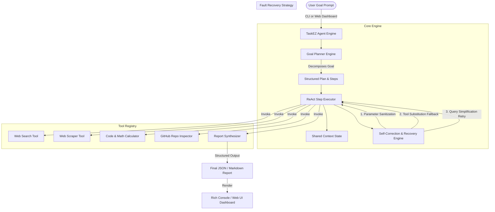

# TaskEZ Architecture & Control Flow

## System Architecture Diagram

## Control Flow Sequence

1. **Goal Acceptance**: The system accepts a natural language prompt via CLI or Web Dashboard.
2. **Decomposition & Planning**: The `GoalPlanner` inspects goal patterns, identifies the goal domain (GitHub analysis, travel & budget, research summarization), and produces an explicit sequence of `Step` specifications.
3. **Trace Broadcast**: The initial plan is emitted to the visual planning trace via WebSockets or Rich console.
4. **Step Execution Loop**:
   - The executor picks the next pending `Step`.
   - Tool arguments are enriched with context from previous step results.
   - The assigned tool is invoked with runtime timing and safety validation.
5. **Fault Detection & Self-Correction**:
   - If a tool execution fails (or if failure is deliberately injected via `--inject-failure`), `SelfCorrectionManager` intervenes.
   - It selects a recovery policy (parameter fix, tool substitution fallback, or query retry) and updates step state.
   - Recovery trace is logged and execution resumes.
6. **Report Synthesis**: Gathered context is compiled by `ReportGeneratorTool` into a structured report.
